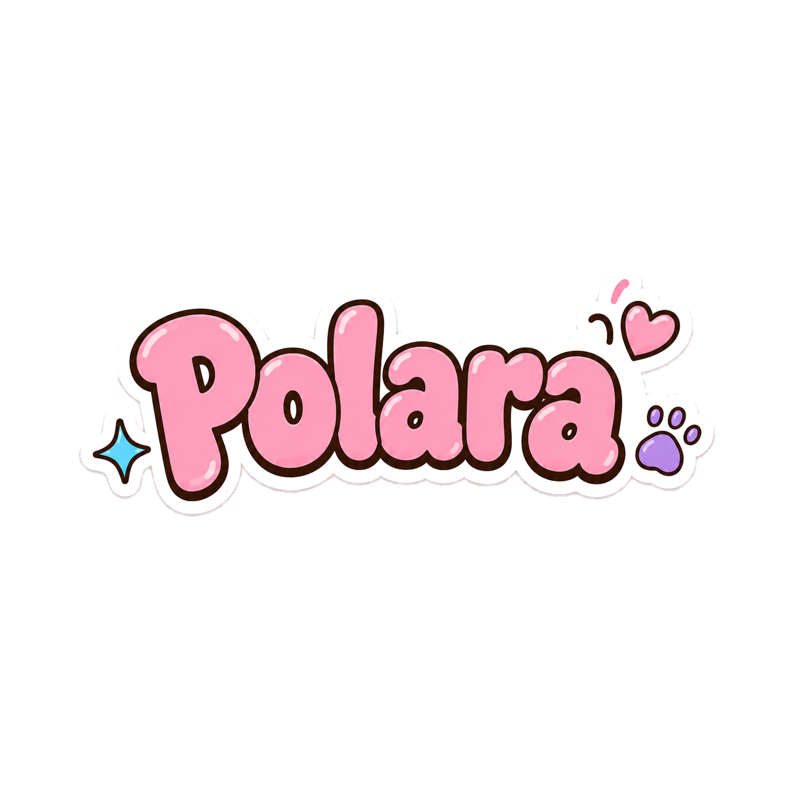

# Polara v1.1.2



Polara adalah photobooth di browser untuk mengambil foto, memilih frame, dan
menyimpan hasilnya sebagai PNG. Foto diproses di perangkat pengguna tanpa akun
atau upload ke server Polara.

[Buka Polara](https://polara.vercel.app/) · [Catatan versi](CHANGELOG.md) ·
[Henry Nugraha](https://hnry.dev/)

## Cara memakai

Alurnya: **Start → Camera → Review → Frames → Decorate → Reveal**.

1. Pilih Strip 3 atau Single. Strip 3 menjadi pilihan awal.
2. Buka kamera dan pilih timer 3, 5, atau 10 detik sebelum mengambil foto.
   Jika kamera tidak tersedia, gunakan Demo mode untuk mencoba dengan foto contoh.
3. Periksa foto. Retake mengganti satu slot setelah foto pengganti berhasil diambil.
4. Pilih frame. Klik foto pada preview atau nomor fotonya untuk menyesuaikan
   crop, posisi, dan pilihan Full photo atau Fill frame.
5. Tambahkan stiker bila ingin menghias. Hasil tetap bisa disimpan tanpa dekorasi.
6. Di Reveal, pilih Save PNG, Photo only, atau Share. Jika browser tidak mendukung
   berbagi file, Polara menawarkan unduhan.

Pose Mate adalah pilihan tambahan di awal sesi. Match pose dan Sit together
menempatkan pendamping di dalam jendela foto. Di Camera atau Frames, buka
Adjust Pose Mate untuk mengubah posisi, ukuran, sisi, atau mengembalikannya ke
posisi awal. Pengaturan tersimpan terpisah untuk tiap foto dan jenis pose selama sesi.

| Format | Foto | Ukuran PNG |
| --- | ---: | --- |
| Single | 1 | 1080 × 1350 px |
| Strip 3 | 3 | 720 × 1800 px |

Katalog berisi 26 variant dari sembilan keluarga frame. Setiap keluarga memiliki
Poca Exclusive opsional, di samping stiker yang bisa dipakai lintas keluarga.
Preview dan export menggunakan geometry, crop, mask, serta overlay yang sama.

## Foto, demo, dan privasi

- Polara meminta izin kamera ketika pengguna memasuki Camera, bukan saat halaman dibuka.
- Foto dan edit hanya berada dalam sesi browser. Simpan hasil sebelum reload,
  menutup tab, atau memulai New session. Polara tidak menyediakan pemulihan sesi.
- Demo mode memakai tiga foto contoh fiktif. Penanda demo tetap tampil di Camera
  agar foto contoh tidak disalahartikan sebagai hasil kamera.
- Save mengunduh file ke perangkat. Share menyerahkan file ke fitur berbagi
  browser/perangkat setelah pengguna memintanya.
- Aplikasi memuat aset web dan font. Pemrosesan foto secara lokal bukan berarti
  halaman tidak membuat permintaan jaringan sama sekali. Font UI dimuat dari
  Google Fonts; tidak ada klaim dukungan offline penuh.

## Menjalankan lokal

Frontend memakai HTML, CSS, dan JavaScript modules tanpa framework atau proses
build. Server pengembangan membutuhkan Python 3. Jalankan dari root repository:

```powershell
cd "C:\HenryDev\1HenryDev\HenryLabs\polara"
python serve.py 5511
```

Buka [127.0.0.1:5511](http://127.0.0.1:5511/). Server hanya mendengarkan localhost
dan menonaktifkan cache supaya perubahan langsung terlihat. Hentikan dengan
Ctrl+C. Jika perintah `python` tidak tersedia, gunakan `py -3` atau path lengkap
Python yang terpasang. Sesuaikan lokasi folder jika clone berada di tempat lain.

Jangan membuka `index.html` melalui `file://`. Kamera membutuhkan konteks aman,
seperti localhost atau HTTPS. Server ini khusus pengembangan, bukan server produksi.

## Struktur repository

```text
index.html                  Shell, kontrol, dialog, metadata website
src/
  app.js                    Alur sesi dan penghubung antarmodul
  core/                     Kamera, geometry foto/Pose Mate/stiker, export
  modules/
    templates/              Registry overlay, renderer, perilaku picker
    guests/                 Pilihan dan komposisi Pose Mate
    stickers/               Katalog stiker dan Poca
  ui/                       Timer, rail, koleksi, Reveal, kontrol posisi
styles/                     Token desain dan layout responsif
assets/
  brand/                    Logo dan watermark
  frames/                   Overlay, manifest, thumbnail, composite picker
  guests/                   Aset Pose Mate dan manifest
  mascot/                   Poca untuk UI
  stickers/                 Stiker produksi
  media/demo-proofs/        Foto contoh untuk Demo mode
schemas/                    Schema manifest frame
scripts/                    Generator aset, validator, dan QA browser
tests/                      Regresi logika, kontrak aset, dan UI
serve.py                    Server pengembangan lokal
```

Ikon browser, manifest web, dan gambar social preview berada di root karena
dirujuk oleh metadata website. File-file tersebut bukan file sementara.

`docs/`, `spec/`, `PRODUCT.md`, `DESIGN.md`, serta `assets/_originals/` adalah
konteks/master lokal yang di-ignore. File-file itu bukan kebutuhan runtime dan
tidak tersedia pada clone biasa. README dan CHANGELOG adalah dokumentasi publik.

## Pengujian

Tes JavaScript memakai Node.js test runner bawaan dan tidak membutuhkan
instalasi dependency aplikasi:

```powershell
npm test
```

Pemeriksaan aset tambahan:

```powershell
npm run assets:verify
npm run test:python
npm run frames:verify
npm run assets:previews:check
```

Pemeriksaan Python membutuhkan Pillow. Sebagian validasi/generator juga
membutuhkan master privat di `assets/_originals/`; menjalankan website dan
tes JavaScript tidak membutuhkan master tersebut. Jangan membuat file pengganti
sekadar agar pemeriksaan master lulus.

QA browser memakai Playwright dan Chrome. Pasang Playwright hanya bila belum
tersedia di lingkungan kerja:

```powershell
npm install --no-save --package-lock=false playwright
$env:POLARA_CHROME_PATH = "C:\Program Files\Google\Chrome\Application\chrome.exe"
npm run qa:proof-table -- docs/qa/local-check
```

Jika Playwright disediakan oleh lingkungan kerja, `POLARA_PLAYWRIGHT_MODULES`
dapat menunjuk folder `node_modules` tersebut. Runner membuat server sementara,
memakai kamera sintetis/foto demo, dan menyimpan screenshot serta PNG di folder
QA lokal yang di-ignore. Jangan mengganti folder bukti rilis tanpa sengaja.

Matrix mencakup 390×844, 768×1024, 1440×900, dan 900×510. Pengujian browser
otomatis tidak menggantikan pengujian kamera fisik, Safari, unduhan ke galeri,
atau native Share di Android/iPhone.

## Menambah atau merapikan aset

- Manifest frame adalah sumber geometry. Jangan mengubah thumbnail secara
  terpisah dari overlay dan geometry asalnya.
- Overlay PNG digunakan pada hasil foto. Composite hanya untuk gambar pilihan
  frame; thumbnail frame-only tetap tersedia sebagai fallback.
- Simpan aset produksi dalam folder domainnya. ZIP, hasil ekstraksi, master,
  review board, dan prototype tidak masuk runtime.
- Generator dan tes yang masih menjaga katalog tetap dipertahankan. Hapus file
  hanya setelah referensi kode, manifest, dan kebutuhan regenerasinya diperiksa.
- Jangan menganggap izin melihat atau memakai aplikasi sebagai izin untuk
  memakai ulang artwork atau wajah dalam pack. Repository ini tidak menyertakan
  lisensi umum penggunaan ulang aset.

Polara tidak memiliki backend, database, akun, pembayaran, atau galeri cloud.
Pengembangan berikutnya diprioritaskan dari temuan penggunaan nyata, terutama
komposisi Pose Mate, keterbacaan frame, dan pengalaman menyimpan di ponsel.
